# 🛡️ Awesome Next-Gen SIEM & Security Analytics 🚀

### *Curated Benchmark of AI-Native SIEM Platforms, Security Data Lakes & Open-Source SOC Frameworks*

  
  
  
  
  
  

**Last updated: November 2026**

---

## 📖 Executive Summary & Scope 🔍

This repository serves as a vendor-neutral directory and architectural evaluation guide for **Next-Generation Security Information and Event Management (NG-SIEM)** and **Security Analytics Platforms**. Modern Security Operations Centers (SOCs) are moving beyond monolithic, legacy log aggregation appliances. Today's architectures emphasize:

- 🤖 **Agentic & Generative AI:** Multi-agent autonomous investigations, automated alert triaging, and dynamic MITRE ATT&CK correlation.
- 🌊 **Security Data Lakes & Schema Normalization:** Decoupled storage-compute architectures on OCSF (Open Cybersecurity Schema Framework), Snowflake, BigQuery, and S3-compatible object storage.
- 🎯 **Detection-as-Code (DaC):** CI/CD-driven rule authoring, automated unit testing, and cross-platform Sigma/YARA-L rule translation.
- 👤 **Behavioral Analytics (UEBA):** Machine-learned user, credential, and entity anomaly baselining to preempt identity theft, insider threats, and lateral movement.
- ⚡ **Self-Hosted & Open-Source Options:** Production-ready open-source engines for organizations prioritizing sovereign data control and zero telemetry taxes.

---

## 📑 Table of Contents 🗂️

- [📊 Sector Overview & Market Dynamics](#-sector-overview--market-dynamics)
- [☁️ Top SaaS & Hosted Enterprise SIEM Platforms](#️-top-saas--hosted-enterprise-siem-platforms)
- [🛡️ Open-Source GitHub Projects](#️-open-source-github-projects)
- [🎯 SIEM Evaluation Criteria & Selection Framework](#-siem-evaluation-criteria--selection-framework)
- [🤝 How to Contribute](#-how-to-contribute)
- [⚠️ Disclaimer](#️-disclaimer)
- [📈 Star History](#-star-history)
- [💖 Support & Community](#-support--community)

---

## 📊 Sector Overview & Market Dynamics 📈

The global **Next-Generation SIEM and Security Analytics market** reached approximately **$5.4 billion in 2024** and is projected to expand to **$12.8 billion by 2030**, reflecting a vigorous Compound Annual Growth Rate (**CAGR of 15.2%**). 

The industry demonstrates a **moderately concentrated** structure at the mega-cap layer—dominated by hyper-scale cloud providers and security titans (*Microsoft, Cisco/Splunk, Google Cloud, and CrowdStrike*) who monetize existing endpoint and infrastructure footprints. Concurrently, the sector exhibits **vibrant ongoing fragmentation** across specialized niches. Independent and modern contenders compete aggressively on schema-less indexing, autonomous investigation agents, and open lakehouse interoperability (such as Snowflake and Databricks integrations). High switching costs and ballooning log ingestion taxes have prevented a single "winner-take-all" monopoly, spurring substantial M&A consolidation (e.g., Cisco's acquisition of Splunk for $28B and Exabeam's merger with LogRhythm) as legacy architectures strive to modernize against cloud-native, agentic competitors.

---

## ☁️ Top SaaS & Hosted Enterprise SIEM Platforms 🏢

The following table provides verified pricing structures, free trial limits, company valuation/revenue metrics, and architectural highlights. **Sorted in descending order by parent company valuation / market size.**

| Product & Vendor | Valuation / Revenue 💰 | Starting Tier Pricing 🏷️ | Free Tier / Trial Limits ⏱️ | Key Capabilities & Architecture ⚙️ | Best For 🎯 |
| :--- | :--- | :--- | :--- | :--- | :--- |
| **[Microsoft Sentinel](https://learn.microsoft.com/azure/sentinel/)**  *(Microsoft)* | **~$3.1 Trillion**  *(~$245B Annual Rev)* | **$4.30 / GB** pay-as-you-go ($2.30/GB Log Analytics + $2.00/GB Sentinel analysis); drops to **$2.96 / GB** on 100 GB/day commitment tier ($296/day). | **31-day free trial** with up to **10 GB/day ingestion waived** (310 GB total), max 20 trial workspaces per tenant. Permanent free ingestion for Azure Activity & Office 365 audit logs. | AI-native security data lake; Security Copilot generative assistant; 350+ out-of-the-box data connectors; Security Graph correlation; hosted Model Context Protocol (MCP) server for AI agents. | Enterprises deeply integrated with Azure, Microsoft 365 E5, and hybrid enterprise clouds. |
| **[Google Security Operations](https://cloud.google.com/chronicle)**  *(Alphabet / Google Cloud)* | **~$2.1 Trillion**  *(~$350B Annual Rev)* | **~$1.95 / GB/year** (Standard tier baseline under annual prepaid ingestion credit commitments; Enterprise at ~$2.40/GB/yr; Enterprise Plus at ~$4.60/GB/yr). | **No public self-service trial.** 30-day sales-assisted Proof of Concept (PoC). Includes Data Benefit Program with **10 GB/day free GCP Audit Logs & 10 GB/day Google Workspace logs**. | Unified Data Model (UDM) ingestion; YARA-L rule language; sub-second petabyte search across 12-month hot retention; native Gemini Cloud Security AI and Mandiant threat intelligence. | Google Cloud-centric organizations and engineering-led SOCs requiring petabyte-scale search speed. |
| **[Splunk Enterprise Security](https://www.splunk.com/)**  *(Cisco Systems)* | **~$230 Billion**  *(Cisco parent cap; Splunk standalone ~$4.2B Rev)* | **$2,277 / GB/day/year** list price base tier (1 GB/day), scaling to **$575–$759 / GB/day/year** at 100+ GB/day + ES add-on license; or workload-based per vCPU/SVC. | **60-day free trial** for Splunk Enterprise (on-prem) or **14-day free trial** for Splunk Cloud (5 GB/day cap). Permanent *Splunk Free* is limited to **500 MB/day** (excludes alerting & ES). ES trial requires sales license. | Industry-standard SPL search processing language; Risk-Based Alerting (RBA); mature ecosystem with 2,500+ Splunkbase apps; native integration with Cisco Talos threat feeds. | Large enterprise SOCs with seasoned SPL detection engineering teams and complex on-prem/hybrid footprints. |
| **[IBM QRadar SIEM](https://www.ibm.com/products/qradar-siem)**  *(IBM)* | **~$200 Billion**  *(~$62B Annual Rev)* | **~$12,000 / year** baseline for 500 EPS (Events Per Second) / 10,000 FPM package on cloud marketplaces (entry tiers range $10,000–$25,000/year sub-2,500 EPS). | **Free-forever QRadar Community Edition** capped at **100 EPS & 5,000 FPM** with renewable license for labs/testing; 14-day guided enterprise SaaS trial via IBM sales. | Native Sigma rule evaluation; automated offense chaining; federated search across STIX/TAXII data sources; Watsonx AI automated threat investigation and triage. | Highly regulated enterprises, financial institutions, and government bodies requiring structured on-prem compliance. |
| **[CrowdStrike Falcon Next-Gen SIEM](https://www.crowdstrike.com/products/next-gen-siem/)**  *(CrowdStrike)* | **~$85 Billion**  *(~$3.9B Annual Rev)* | **~$5.95 / GB** ($0.00595/MB on AWS Marketplace) for 3rd-party log ingestion with 13-month storage. **Falcon-native endpoint telemetry ingested at $0 cost**. | **10 GB/day permanent free third-party data ingestion** for existing Falcon Insight XDR customers; 15-day free trial of Falcon platform (no credit card required). | Index-free architecture powered by LogScale; Agentic AI investigations where orchestrator summons specialist agents across domains in parallel; detection-as-code pipeline. | Falcon endpoint customers looking to consolidate EDR, XDR, and SIEM onto a single high-speed telemetry plane. |
| **[Datadog Cloud SIEM](https://www.datadoghq.com/product/cloud-siem/)**  *(Datadog)* | **~$42 Billion**  *(~$2.6B Annual Rev)* | **$5.00 / GB or per 1M analyzed events** (annual commitment; $6.00/unit on-demand) + standard log ingestion at **$0.10 / GB**. | **14-day full-feature free trial** with access to Cloud SIEM, Log Management, Infrastructure Monitoring, and pre-built detection rules with no hard event cap. | Bits Security AI automated signal investigation; OCSF-aligned detection engine; out-of-the-box cloud posture rules (AWS, Azure, GCP, Okta, GitHub); unified APM/SIEM tracing. | Cloud-native engineering teams, DevOps-heavy environments, and existing Datadog observability users. |
| **[Elastic Security](https://www.elastic.co/security)**  *(Elastic N.V.)* | **~$9.5 Billion**  *(~$1.4B Annual Rev)* | **$99 / month** (Cloud Hosted Standard tier; Platinum at $131/mo; Enterprise at $184/mo); Serverless Security from **$0.09 / GB** ingest + **$0.017 / GB/month** storage. | **100% Free forever** self-managed via Elastic Basic license (includes pre-built rules & Elastic Defend EDR). **14-day free trial** on Elastic Cloud with full feature access. | Searchable snapshots on S3/GCS/Azure Blob for cold petabyte storage; 1,000+ pre-built detection rules mapped to ATT&CK; Elastic Defend integrated EDR; open schema (ECS). | Teams seeking open-core flexibility with transparent upgrade paths between self-managed clusters and hosted SaaS. |
| **[Exabeam New-Scale SIEM](https://www.exabeam.com/)**  *(Exabeam / LogRhythm)* | **~$2.4 Billion**  *(Combined merged rev ~$200M)* | **~$75,000 / year** starting enterprise commitment based on daily log ingestion capacity tiers (GB/day). | **No public self-service trial.** 14 to 30-day structured **Proof of Value (POV)** pilot conducted in customer production environment with sales engineering support. | Exabeam Nova AI conversational agents; behavioral baseline tracking (UEBA); Threat Center unified workbench for triage and incident investigation; automated correlation playbooks. | Organizations prioritizing credential theft detection, insider threat modeling, and behavioral analytics. |
| **[Sumo Logic Cloud SIEM](https://www.sumologic.com/solutions/cloud-siem/)**  *(Francisco Partners)* | **~$1.7 Billion**  *(Acquisition valuation; ~$300M Annual Rev)* | **$0.225 / credit** (Enterprise Security tier) with annual minimum commitment; Cloud Flex credit model burns credits on search scans, storage, and SIEM ingest. | **30-day free trial** with full access to Cloud SIEM and analytics; permanent *Sumo Logic Free* plan supports up to **500 MB/day** log ingestion with 7-day retention. | MITRE ATT&CK Coverage Explorer; adaptive signal clustering to minimize alert fatigue; Mobot natural language query assistant; GitHub-driven detection-as-code versioning. | Cloud-first SOCs needing automated signal deduplication and streamlined compliance log retention. |
| **[Securonix Unified Defense SIEM](https://www.securonix.com/)**  *(Securonix)* | **~$1.5 Billion+**  *($1B+ Vista Equity Investment)* | **~$35,000–$50,000 / year** entry-level capacity tiers based on GB/day ingestion; hybrid commitment with predictable overage pricing. | **No automated public trial.** 30 to 60-day guided enterprise **Proof of Concept (PoC)** with telemetry onboarding and free legacy SIEM migration assessments. | Snowflake-backed cloud security data lake architecture; SNYPR behavioral risk scoring; automated threat hunting workbench; long-term cost-efficient cold storage. | Large global enterprises and MSSPs wanting deep UEBA risk modeling combined with cloud data lake scalability. |

---

## 🛡️ Open-Source GitHub Projects 💻

Open-source tooling in Next-Gen SIEM provides transparent detection logic, customizable data pipelines, and cost avoidance on telemetry ingestion taxes. 

The list below features standout projects across core SIEM platforms, telemetry collection engines, detection rule standards, and incident response frameworks. **Sorted in descending order by GitHub_Stars.**

| Repository & Project | GitHub_Stars 🌟 | Primary Category 🏷️ | License 📄 | Architecture & Strengths ⚡ |
| :--- | :---: | :--- | :--- | :--- |
| **[Elasticsearch](https://github.com/elastic/elasticsearch)** |  | Core Search & Analytics Engine | AGPL-3.0 / Elastic-2.0 | Distributed, RESTful search engine powering Elastic Security SIEM; index lifecycle management; Lucene-based inverted indexing for hyper-fast security queries. |
| **[Osquery](https://github.com/osquery/osquery)** |  | Endpoint Telemetry & Audit | Apache-2.0 | SQL-powered endpoint instrumentation framework (macOS, Windows, Linux); transforms OS state into relational tables for continuous threat hunting and SIEM ingestion. |
| **[Wazuh](https://github.com/wazuh/wazuh)** |  | Full SIEM & XDR Platform | GPL-2.0 | Complete open-source SIEM/XDR suite; agent-based log collection; real-time file integrity monitoring (FIM); vulnerability detection; SCA compliance; Wazuh Indexer & Dashboard. |
| **[Sigma](https://github.com/SigmaHQ/sigma)** |  | Detection-as-Code Standard | DRL / LGPL-2.1 | Generic, vendor-agnostic signature format for log events; acts as the "YARA for log files"; converts rules dynamically into Splunk SPL, Microsoft Sentinel KQL, QRadar AQL, and Elasticsearch DSL. |
| **[Graylog](https://github.com/Graylog2/graylog2-server)** |  | Centralized Log Management & SIEM | SSPL-1.0 | Fast centralized log aggregation and security analytics engine; pipeline processing rules; stream-based alerting; intuitive dashboards; supports Elasticsearch/OpenSearch backends. |
| **[Zeek](https://github.com/zeek/zeek)** |  | Network Security Telemetry | BSD-3-Clause | Powerful network analysis framework converting raw packets into structured, behavioral connection and protocol audit records (DNS, HTTP, SSL/TLS, Kerberos) for SIEM enrichment. |
| **[Suricata](https://github.com/OISF/suricata)** |  | Network Threat Detection (NIDS/IPS) | GPL-2.0 | High-performance multi-threaded network threat detection and protocol decoding engine; emits standard EVE JSON output for direct ingestion into modern SIEM data lakes. |
| **[MISP](https://github.com/MISP/MISP)** |  | Threat Intelligence Platform (TIP) | GPL-3.0 | Open-source threat intelligence platform for sharing, correlating, and storing IOCs and threat actors; seamlessly feeds contextual threat intel into SIEM correlation rules. |
| **[Security Onion](https://github.com/Security-Onion-Solutions/securityonion)** |  | Comprehensive SOC Distribution | AGPL-3.0 | Turnkey Linux distro for enterprise threat hunting, network security monitoring (NSM), and log management; bundles Wazuh, Zeek, Suricata, and OpenSearch/Elastic into a unified SOC interface. |
| **[TheHive](https://github.com/TheHive-Project/TheHive)** |  | Incident Response & Case Management | AGPL-3.0 | Scalable security incident response platform tightly integrated with SIEM alerts; collaborative real-time case investigation; dynamic task assignment; Cortex observable analyzer integration. |
| **[Shuffle](https://github.com/Shuffle/Shuffle)** |  | Open-Source SOAR | Apache-2.0 / AGPL-3.0 | General-purpose Security Orchestration, Automation, and Response (SOAR); visual workflow builder; connects SIEM alerts to automated firewall blocking, ticket updates, and Slack notifications. |
| **[OpenSearch Security Analytics](https://github.com/opensearch-project/security-analytics)** |  | Security Analytics Plugin | Apache-2.0 | Apache-2.0 native security analytics plugin for OpenSearch; Sigma rule detector support; correlation engine connecting findings across multiple log sources; integrated threat intelligence. |

---

## 🎯 SIEM Evaluation Criteria & Selection Framework 📐

When evaluating Next-Gen SIEM and Security Analytics solutions, security architects should apply a 6-pillar framework:

1. **Ingestion & Storage Economics (The "Log Tax" Problem)**:
   - Does the platform charge per raw gigabyte, per indexed field, per analyzed event, or by compute worker?
   - Can cold compliance telemetry be relegated to cheap object storage (S3/Azure Blob/GCS) with on-demand federated queries?
2. **Data Model & Normalization**:
   - Is telemetry mapped to an open standard like **OCSF (Open Cybersecurity Schema Framework)** or **ECS (Elastic Common Schema)**, or locked in proprietary formats?
3. **AI & Autonomous Investigation Capabilities**:
   - Does the tool offer deterministic agentic workflows (e.g. multi-step context gathering across IP, host, and identity) or just superficial LLM summarization chatbots?
4. **Detection-as-Code & Community Ecosystem**:
   - Can detection rules be developed in Git repositories with automated syntax linting and regression testing?
   - Is there native translation for **Sigma**, **YARA-L**, and **KQL**?
5. **Entity & Identity Analytics (UEBA)**:
   - Does the solution track peer group behaviors, anomalous session hops, privilege escalation spikes, and dormant account activations?
6. **Self-Hosting Feasibility vs. Operational Overhead**:
   - For open-source options (e.g. Wazuh, Elastic, OpenSearch), does your engineering team have the bandwidth for cluster indexing tuning, sharding maintenance, and schema curation?

---

## 🤝 How to Contribute 🛠️

We warmly welcome community contributions to keep this ecosystem accurate, comprehensive, and up-to-date!

1. 🍴 **Fork the repository** on GitHub.
2. 🌿 **Create a feature branch**: `git checkout -b feature/add-new-siem-tool`.
3. 📝 **Add or update entries**: Follow the existing Markdown table format. Ensure pricing, valuation, and free tier limits are verified with citations.
4. 🧪 **Validate links & formatting**: Ensure links are live and badges conform to standard formatting.
5. 📬 **Submit a Pull Request** with a concise description of your additions.

---

## ⚠️ Disclaimer 📌

- This repository is a **community-curated informational resource** — it is not sponsored by, affiliated with, or endorsed by any vendor mentioned herein.
- Enterprise software pricing, packaging structures, and feature tiers change frequently. All pricing estimates reflect public cloud marketplace figures, G-Cloud schedules, and vendor documentation as of **November 2026**. Always consult vendors directly for contractual enterprise quotations.
- **Open-source security tooling** places full operational responsibility (high availability, patch management, rule maintenance, and compute scaling) on the adopting organization. Always conduct rigorous staging evaluations before deploying in mission-critical production environments.

---

## 📈 Star History

---

## 💖 Support & Community 🙏

Thank you for exploring and bookmarking the **Awesome Next-Gen SIEM & Security Analytics** directory! 

Maintaining rigorous, continuously updated security architecture benchmarks takes significant research and dedication. If this repository provided value to you or your security team:

- ⭐ **Star this repository** to support discoverability across the open-source cybersecurity community.
- 🍴 **Fork and share** with your SecOps team, threat hunters, and SOC engineering colleagues.
- 💬 **Join our community discussion** on our [Discord Server](https://discord.gg/jc4xtF58Ve).
- ☕ **Support the maintainer**: If you would like to buy a coffee or sponsor continuous research, please visit the [GitHub Sponsors Dashboard](https://github.com/sponsors/ishandutta2007).
